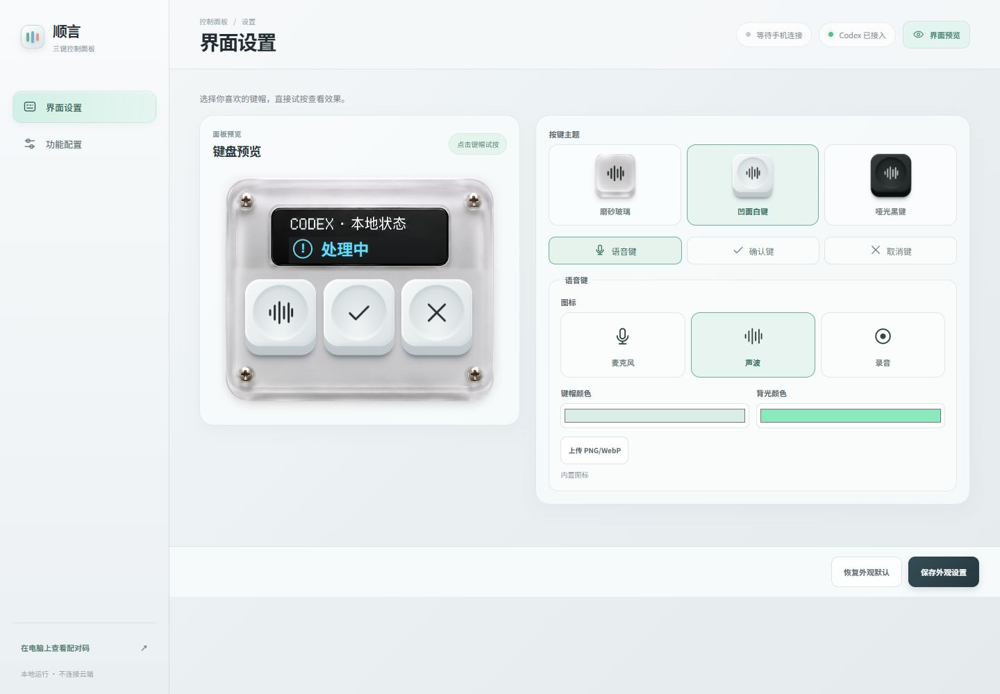
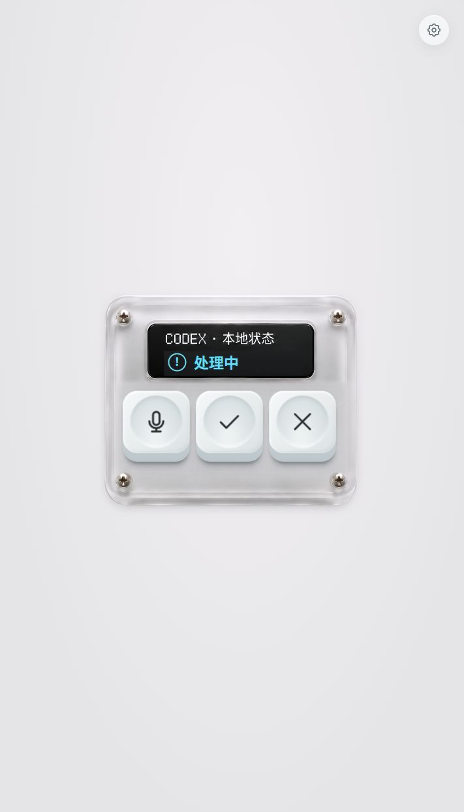
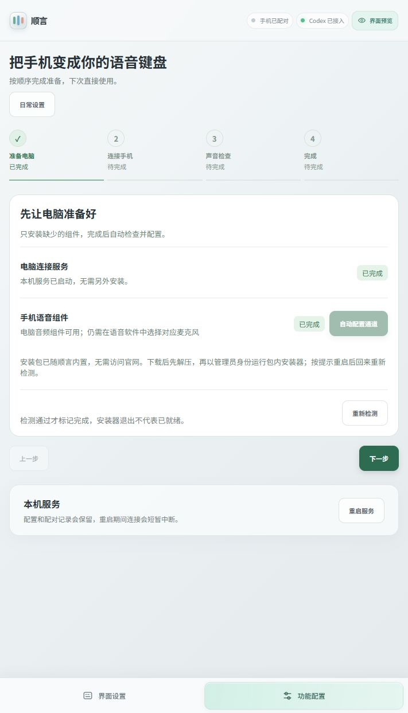

# 顺言 Shunyan

**把手机变成电脑旁的三键语音控制器。**

用手机上的语音键开始说话，用确认键提交，用取消键结束当前操作。顺言通过你设置的键盘快捷键与电脑软件配合，也能将手机麦克风的声音传到电脑，适合搭配闪电说等语音输入工具使用。

手机用浏览器访问，电脑运行本机服务。前台只有三个按键和一块状态小屏，常用操作随手可及。

> 当前为开发预览版，建议先在 Windows 上试用。Windows 本机功能已进行验证；手机语音完整链路与 macOS 实机兼容性仍在验收中。兼容情况见下方说明。

## 主要功能

| 功能 | 你可以怎么用 |
| --- | --- |
| 三键控制 | 语音、确认、取消分别映射为电脑键盘按键，减少来回找快捷键的操作。 |
| 两种说话方式 | **点按切换**：点一次开始，再点一次停止；**按住说话**：按住录音，松开停止。 |
| 自定义快捷键 | 支持单键、左右 Alt / Ctrl / Shift / Command 等修饰键及组合键。点击设置框后直接按实体键盘录入。 |
| 使用手机麦克风 | 手机采集声音，经局域网转发到电脑的虚拟音频通道，供语音输入软件使用。 |
| Codex 状态小屏 | 查看待命、处理中、需要确认、完成等状态；在电脑端按会话标题选择要关注的对话。此功能可选。 |
| 按键外观定制 | 提供磨砂玻璃、凹面白键、哑光黑键三种主题；可调整图标、颜色与背光，或上传自己的图标。 |
| 实时外观预览 | 选择后立即查看效果，还能在预览中试按，试按不会发送电脑快捷键。 |
| 多设备配对 | 保存多台手机的配对记录，查看在线情况，随时移除不用的设备。录音通道同一时刻由一台设备使用。 |
| 首次使用引导 | 按“准备电脑 → 连接手机 → 声音检查 → 完成”操作，每一步检测通过后才显示已完成。 |
| 分端设置 | 电脑负责快捷键、录音方式、组件和外观；手机负责连接、证书与麦克风准备。 |

### 一个实际例子

假设你在闪电说中使用**右 Alt**作为语音输入快捷键：

1. 在顺言电脑端，将语音开始和停止都设为右 Alt。
2. 确认键设为 Enter，取消键设为 Esc，也可以换成你习惯的按键。
3. 把电脑光标放到要输入文字的位置，用手机上的语音键开始说话。
4. 说完停止录音，再按需要确认或取消。实际效果取决于目标软件的快捷键设置和当前焦点。

如果要用**手机麦克风**，还需完成音频组件安装和声音检查；如果只使用电脑麦克风，快捷键控制可单独使用。

## 系统截图

以下为实际网页界面截图。主题、图标、连接状态和 Codex 状态会随设置及运行情况变化。

### 界面设置：边选边看，按自己的习惯调整

三种键帽主题、独立按键图标、键帽颜色和背光颜色集中放在同一页，旁边直接展示键盘效果。



### 三键前台：打开后专注于操作

前台仅保留状态小屏、语音键、确认键、取消键与设置入口。下面展示凹面白键主题。

<p align="center">
  
</p>

### 首次准备：知道下一步该做什么

先检查电脑组件，再连接手机、检查声音。截图中的电脑组件已检测通过，其余步骤仍等待实际完成。

<p align="center">
  
</p>

## 第一次怎么用

### 1. 在电脑打开顺言

电脑先启动顺言本机服务，再打开它的设置页。当前仓库提供源码；需要自己部署时，可展开后面的启动说明。

后台只有两个模块：

- **界面设置**：选择主题，调整图标、颜色和背光。
- **功能配置**：安装组件、连接手机、配置按键和录音方式，以及可选的 Codex 接入。

### 2. 完成电脑准备

要使用手机麦克风，在“功能配置”的第一步点击**安装语音组件**。Windows 安装包已经随项目内置，点击后从运行顺言的电脑下载，无需到官网寻找。

下载后先解压，再以管理员身份运行包内官方安装器，按提示完成安装及必要的重启，回到顺言点击**重新检测**。检测通过后会配置音频通道；缺失、占用或异常时不会直接标记成功。

### 3. 连接手机

让手机与电脑处于可互相访问的局域网，在电脑页面查看连接二维码，用手机扫码配对。

首次使用手机麦克风，需要可信的 HTTPS 连接。手机页面提供证书下载和安装说明；iPhone / iPad 下载后还需在系统设置中安装描述文件并开启证书信任，网页无法代替系统完成这些操作。

### 4. 检查声音并开始使用

允许手机浏览器使用麦克风，按页面引导测试声音。在闪电说等目标软件中选择对应的虚拟麦克风，并实际说一句话，确认能够识别。

完成后打开三键前台即可。Codex 状态接入是独立的可选配置，未接入也可以使用快捷键和语音功能。

## 支持情况

| 环境 | 当前情况 |
| --- | --- |
| Windows 电脑 | 主机服务、键盘控制、VB-CABLE 双端点检测及通道打开、配置保存和 Codex 状态已有本机验证。 |
| macOS 电脑 | 已提供键盘适配和 BlackHole 2ch 检测源码，系统权限、实际键盘事件及音频仍需 Mac 实机验收。BlackHole 安装包尚未内置。 |
| iPhone / iPad | 设计为通过 Safari 网页使用，麦克风需要 HTTPS、证书信任和用户授权；完整语音链路仍需持续实机验证。 |
| Android 手机 | 设计为通过支持 AudioWorklet 的现代浏览器使用，需要 HTTPS 与麦克风授权；完整语音链路仍需持续实机验证。 |

自动化测试覆盖模拟键盘、内存音频、配对、配置、权限边界和重启准备流程，不等于所有设备与目标软件均已通过实机验收。

## 常见问题

**为什么闪电说里没有“我的手机”这个麦克风？**

手机声音经过电脑的虚拟音频通道输入，设备名称由驱动提供。Windows 使用内置 VB-CABLE 时，通常在闪电说中选择 **CABLE Output（VB-Audio Virtual Cable）**；macOS 使用 **BlackHole 2ch**。普通扬声器、显示器或名称相似的其他远程音频设备不能直接视为手机麦克风。

**驱动装好了，为什么还显示待完成？**

先确认官方安装器是否要求重启电脑，再在顺言中点击“重新检测”。新版检测会在空闲时刷新音频设备列表；正在录音时会拒绝刷新。长期未更新的后台需要加载新版本服务。

**按了按钮，为什么操作的不是我想用的软件？**

顺言发送的是映射后的键盘按键。请确认目标软件快捷键设置一致，电脑焦点在正确窗口；系统保留快捷键也可能影响录入或触发。

**需要一直打开设置页吗？**

不需要。完成准备后，手机打开三键前台操作即可。电脑本机服务需要保持运行。

**可以在后台重启服务吗？**

电脑端“功能配置”底部提供“重启服务”，会先检查录音和按键状态、备份配置，并在原端口恢复服务。旧后台首次启用需要手动运行本机启动器一次，页面会给出说明。当前首次启动器针对开发用 Windows 主机，迁移到其他电脑时需调整启动方式。

**录音会保存下来吗？**

顺言通过局域网实时转发音频，不保存录音文件。后续语音识别如何处理数据，由你使用的目标语音软件决定。Codex 相关页面展示会话标题和状态摘要。

## 自行部署与开发

<details>
<summary>展开源码启动说明</summary>

当前测试使用 Python 3.11。进入仓库根目录后安装依赖并启动：

```sh
python -m pip install -r host/requirements.txt
python -m host.server
```

macOS 可将 `python` 换成 `python3`。默认访问 `http://127.0.0.1:8765/`，适合电脑本机查看。

手机连接需要绑定电脑实际局域网地址，并准备与该地址匹配、可由手机信任的 TLS 证书。下面的 IP 和证书文件名仅为示例，需替换为实际配置：

```sh
python -m host.server --host 192.168.1.20 --port 8765 --tls-cert server-cert.pem --tls-key server-key.pem --trust-cert phone-root.cer --cert-port 8766
```

常用页面：

| 地址 | 用途 |
| --- | --- |
| `/` 或 `/index.html` | 三键控制器 |
| `/settings.html` | 界面设置与功能配置 |
| `/pairing.html` | 电脑本机查看一次性配对码 |

`8765` 是主服务端口；可选的 `8766` 只提供公开证书引导。证书私钥、配对凭据和用户私有配置不得提交到仓库。Windows 后台使用 `pythonw` 或隐藏窗口启动；更新时替换原实例，保留原配置及配对记录。

详细启动、API 和平台限制见 [本机服务说明](host/README.md) 与 [macOS 说明](docs/macos-platform-notes.md)。

</details>

<details>
<summary>展开验证命令</summary>

```sh
python -m unittest discover -s tests -v
node tests/test_press_parity.cjs
node tests/test_shortcut_recorder.cjs
node tests/test_connection_status.cjs
node tests/test_connection_qr.cjs
```

本轮已通过 99 项 Python 测试、18 项按压检查、11 项快捷键录入检查，以及连接状态和二维码回归检查；网页 JavaScript 语法检查通过。

</details>

## 更多文档

- [首版实施方案](方案.md)
- [AI 开发计划](docs/AI开发计划.md)
- [首次使用分端引导设计](docs/首次使用分端引导设计.md)
- [界面设计与还原规范](docs/界面设计规范.md)
- [本机服务协议](docs/本机服务协议.md)
- [手动重启服务说明](docs/手动重启服务接入-20261117.md)
- [内置 Windows 音频安装包说明](web/drivers/windows/README.md)

## 第三方组件

项目使用 Three.js、二维码生成与识别组件、Noto Sans SC 字体，以及随项目原样提供的 VB-CABLE Windows 安装包。对应来源、版权和许可文件保存在 [web/vendor](web/vendor)、[字体目录](web/assets/fonts) 与 [驱动目录](web/drivers/windows) 中。第三方组件沿用各自许可，发布或专业使用时请同时遵守原作者条款。
