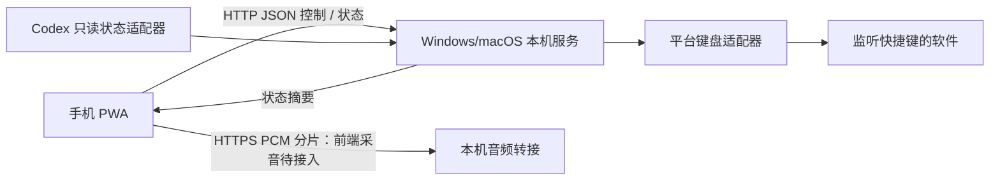

# 顺言（项目代号）AI 开发计划

> 状态：首轮并行代码切片已完成静态集成审阅，设备验收与后续里程碑未开始。产品名称仍待用户选择；界面中的“顺言”暂作项目占位名。
> 日期：2026-11-15

## 1. 首版目标

交付一个手机可访问的 PWA 和运行在 Windows/macOS 电脑上的本机服务。手机页面只提供三个可自定义的按键：语音、确认、取消；语音键支持点按切换与按住说话。按键向电脑发送用户配置的键盘单键或组合键，由电脑系统适配器注入当前系统，不直接控制目标软件。

前台页只显示 Codex 状态屏和三键键盘；设置页独立展示映射、触发方式、键帽样式、图标、本机连接和状态来源。大模型录音整理/文本改写已从首版范围移除。

外观首版支持键帽预设、圆角与每颗键的颜色/背光配置，并允许从内置图标切换或上传 PNG/WebP 自定义图标；为避免脚本注入，不接受 SVG/HTML 或远程图标 URL。

## 2. 架构与并行拓扑

采用“总协调者 + 独立模块并行 + 集成审阅”的层级式协作。模块按目录隔离，公共契约先行，避免多个智能体竞争修改同一文件。

PWA 与服务端共用《本机服务协议》。首轮代码已提供本机配对/API、Windows 与 macOS 键盘适配边界；本轮补入跨平台 PortAudio 虚拟音频播放适配原型。手机端采音、端到端设备验证、TLS 配对交付和 Codex 实际事件源仍在后续验收范围内，不把尚未实测的能力标为可用。

## 3. 子智能体工作包

| 工作包 | 负责范围 | 交付物 | 验收点 |
|---|---|---|---|
| PWA 前端（已交付源码） | `web/` | 控制页、设置页、本机配对码页、PWA 静态资源 | 静态审阅已完成；手机浏览器触控、安装与无障碍仍待设备验收 |
| 本机服务与 Windows（已交付源码） | `host/server.py`、服务公用模块及 Windows 适配器 | Python 标准库 HTTP 服务、配对/配置/按键 API、按键状态清理、Windows `SendInput` 适配器 | 静态审阅已完成；SendInput 按键与本机/手机 HTTPS 连接未实测 |
| macOS 键盘适配（已交付源码） | `host/adapters/macos_keyboard.py`、`docs/macos-platform-notes.md` | CoreGraphics `CGEvent` 键盘适配、权限和原生验收说明 | 静态审阅已完成；Mac 权限、签名和实际按键事件仍待 Mac 实机验收 |
| 总协调与产品契约 | 根目录及 `docs/` | 本开发计划、API 契约、目录集成、静态审阅和限制说明 | 不覆盖他人工作；对照方案核实三键、可自定义、macOS、无 LLM 整理；未做的能力明确列出 |

子智能体不得提交或推送；不得擅自扩大功能范围；不得运行测试、构建或部署命令。本轮只做代码和文档实现及静态审阅，测试/构建需用户另行提出。

## 4. 阶段计划

### M0：需求冻结与模块契约（已完成）

- 冻结三键、手机 PWA、电脑本地服务、Windows + macOS、键盘映射、点按/长按和可自定义外观。
- 冻结 HTTP JSON 协议与平台适配器接口。
- 删除大模型 API、文本优化和目标软件专用控制接口的开发范围。

### M1：并行实现首个可审阅切片（源码已完成，设备验收待进行）

- 完成前台控制器/设置页静态交互与本机 API 客户端。
- 完成本机配对、配置读写、按键 tap/press/release 路由及安全释放。
- 补齐 Windows `SendInput` 与 macOS `CGEvent` 适配。
- 将 Codex 状态屏接到明确的状态接口；在真实数据源接通前显示离线/未知或演示态，不伪造实时状态。

### M2：手机麦克风到虚拟麦克风验证（主机端原型已补入，端到端待验收）

- 主机端使用 PortAudio 列出输出端，用户必须明确选择虚拟音频设备播放端；未选设备时不把手机声音送到物理扬声器。
- 手机端由 AudioWorklet 采集 8–96 kHz 单声道 PCM16，每约 100 ms 发送有序 HTTPS 分片；分片最大 24 KiB、最长 150 ms，3 秒断流自动关闭。
- 当前 HTTP 分片是可测量的首轮原型，需在 iOS Safari、Android Chrome、Windows 和 macOS 测端到端延迟、抖动及断线恢复；结果不达标再迁移 WebSocket/WebRTC。
- 需要由用户预先安装兼容虚拟音频设备并选择匹配的播放/录音端；本软件不安装内核音频驱动。
- iOS 页面失焦、锁屏、音频权限撤销时停止采集并要求用户回到前台恢复。
- macOS 首版可由用户自行安装并选择兼容虚拟音频设备；签名、分发和驱动安装另行评估。

### M3：局域网安全连接与安装体验

- 通过可信 HTTPS 提供麦克风安全上下文；明确证书签发、手机信任和续期流程。
- 电脑本机显示动态配对码/二维码；一次性码限时、限次，配对后使用可撤销会话令牌。
- 服务仅绑定所需局域网接口，不开放公网端口；拒绝未授权来源和请求，限制配对尝试并避免日志记录录音内容。
- Windows 后台启动不弹控制台；macOS 使用登录项/LaunchAgent 的原生安装方式并遵循系统授权。

### M4：Codex 状态适配与跨端验收

- 验证 Codex `app-server` 或其他只读来源是否可获得用户当前会话的事件；没有受支持接口时只显示离线/未知，不读取完整敏感对话。
- 在 Windows 与 macOS 实机分别验证授权、按键映射、组合键顺序、断线释放、音频设备和前后台行为。
- 在 iOS Safari 与 Android Chrome 实机验收配对、触屏、麦克风权限及页面暂停恢复。

## 5. 关键接口和失效处理

- HTTP API 版本以 `/api/v1` 为前缀，完整字段见《本机服务协议》；控制请求含唯一 `requestId`，重复请求不得重复触发不安全状态变更。
- 点按语音键用服务端会话状态实现开始/停止；长按使用显式 press/release；确认与取消使用 tap。
- 会话状态由每 2 秒 status 心跳维持；长按键另用每秒 press 续租，3 秒未续租立即释放，避免状态轮询掩盖 pointerup 丢失。
- 任何服务重启、手机断线、页面退出/失焦或异常会话结束均释放全部已按下键并停止未完成音频会话。
- 主机授权不足、平台不支持的键、配对失败或状态源离线时返回结构化错误并显示中文右上角浮层；不得静默吞掉。
- 键位映射和按键标签使用跨平台语义名，例如 `ALT_RIGHT`、`CTRL_LEFT`、`META_LEFT`、`ENTER`、`ESC`；Windows/Mac 的显示名分别本地化为 Alt/Option、Win/Command。

## 6. 首轮交付边界

当前代码已包含 Windows/macOS 共用的 PortAudio 虚拟播放端输出、手机 AudioWorklet 麦克风采集、带认证与有界 PCM 分片的主机接口、设备选择设置和断线清理。12 项主机/PCM 自动测试、前端语法检查和多视口布局检查通过；尚未完成真实手机麦克风到 Windows/macOS 虚拟音频输入端、再到语音输入软件的端到端验收。不能把代码存在或模拟路由测试表述为可替代实体硬件的验收结果。

首轮不包含：旋钮、控制目标软件私有 API、大模型 API/录音转写整理、云端账户/远程中继、未经验证的 Codex 实时状态读取、虚拟音频驱动安装器。
