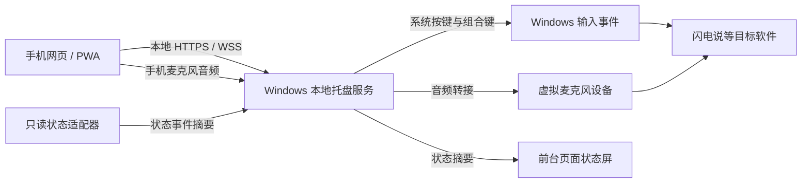

# 三键语音控制面板首版实施方案

> 注：文中和界面设计图里的“顺言”是占位名，最终名称待确认。

## 界面设计稿

- 设置界面：[`design/settings-interface-v2.png`](design/settings-interface-v2.png)
- 前台键盘展示页：[`design/foreground-keyboard-page.png`](design/foreground-keyboard-page.png)

## 产品范围

首版面向 iOS 与 Android 手机，提供可添加到主屏幕的网页控制面板。手机访问电脑上的本地服务，使用手机麦克风，并以三个触控按键向电脑发送系统键盘按键或组合键。首版按 Windows 电脑规划。

手机端显示三键控制器和 Codex 状态屏；电脑端本地服务负责按键注入、手机麦克风音频转接、设备配对和 Codex 状态读取。按键发送给当前快捷键监听软件，不依赖闪电说等目标软件的专用控制接口。

## 首版界面要求

- 主界面绘制小型控制键盘，参考用户提供的 Codex Micro 图片：雾银半透明外壳、独立透光键帽、克制的彩色背光。
- 设备只保留 **三个实体感按键**：语音输入、确认、取消；没有旋钮或额外功能键。
- 三键上方放置模拟小屏，显示 Codex 状态、简短说明、最近反馈和时间。预览状态明确标记为演示，状态服务连通并有真实事件后才显示实时状态。
- **前台展示页**只显示控制键盘本身：状态屏与三颗按键，不显示设置表单、导航栏、状态事件列表或配置内容。桌面和手机均采用沉浸式布局，手机上控制器纵向居中并适配单手触控。
- 三颗键帽只显示图标，不显示“语音 / 确认 / 取消”文字，也不在键帽下方重复标注；语义由麦克风、勾选和叉号图标表达。
- 前台展示页右上角可放置低干扰的设置入口，点击后切换到独立设置页；设置内容不会出现在前台控制页。
- 设置页保留按键映射、点按/长按、快捷键组合、键帽颜色和圆角样式、图标更换、本机服务配对及 Codex 状态来源配置。

## 按键与语音行为

### 语音输入

- 电脑端把手机实时麦克风音频转接到虚拟录音设备，目标语音软件选择该设备作为麦克风。软件仍用自己的语音识别和文本输出流程。
- **点按模式**：第一次点按启动音频并发送配置的开始快捷键；再次点按发送停止快捷键并结束音频流。开始、停止快捷键可以分别配置为单键或组合键。
- **长按模式**：触屏按下时启动音频并发送按键按下事件；松开时释放按键并停止音频，适用于目标软件支持按住说话的情况。
- 本软件只控制快捷键并转接音频，不读取或修改目标语音软件生成的文字。

### 确认与取消

确认和取消默认映射为 Enter、Esc，用户可替换成其他单键或组合键。发送组合键时先按下修饰键，再按主键；释放时反向执行。录音中按取消时先停止音频、释放仍按下的键，再发送配置的取消动作。

网络断开、网页切到后台、触控中断或手机断线时，电脑服务停止音频并释放所有仍处于按下状态的键。

## Codex 状态屏

小屏只显示状态标题、短说明、最近一条事件和时间，不展示完整对话或敏感文本。状态适配器将 Codex 事件归纳为待命、处理中、待确认、已完成、失败或离线，并通过本机服务推送到手机。适配器只读取并归纳状态，不代替用户操作 Codex。

Codex 官方说明提供 `app-server` 作为接收流式事件等集成协议。实施时先验证它与用户实际运行的 Codex 模式是否兼容；若需观察已打开的桌面会话，须确认本机版本提供可用的只读观察方式，再承诺实时反馈。[Codex app-server 集成说明](https://developers.openai.com/blog/codex-as-a-platform)

## 建议架构

### 电脑端服务

- 以当前登录用户会话运行，提供网页、配对、按键映射、音频转接和 Codex 状态适配。
- 使用 Windows 系统输入接口发送用户配置的按键和组合键，采用普通用户权限。管理员权限运行的目标程序可能拒收普通权限进程发出的按键。
- 音频原型优先使用已安装的虚拟音频设备：本地服务向设备播放端输出手机音频，目标软件选择对应的录音端。先验证兼容性和延迟，再决定是否需要自有驱动。
- 后台启动不显示终端窗口；日志写入本地文件，不记录麦克风内容或不必要的会话正文。

### 手机端与网络

- PWA 通过 HTTPS 获取麦克风权限；局域网访问需配置手机信任的证书。
- 同一局域网配对，由电脑显示动态地址二维码和一次性配对码；按键控制与音频使用加密连接，不开放公网端口。
- iOS 页面在后台或锁屏时可能暂停录音，首版以保持页面前台为使用条件，并在断线或权限变化时停止录音、释放按键。
- 麦克风授权、配对成功/失败、保存失败等交互状态使用中文右上角浮层，不在正文插入提示行或改变布局。

## 实施里程碑

1. **交互原型**：三键设备、模拟状态屏、按键映射、点按/长按切换、键帽样式、图标与背光预览。
2. **按键验证**：手机经局域网控制电脑发送右 Alt、Enter、Esc 和组合键，验证按住、松开和断线释放行为。
3. **音频验证**：手机实时麦克风音频送入电脑虚拟麦克风，目标语音软件能够识别；测量延迟、断线恢复和设备切换。
4. **Codex 状态验证**：确认目标运行方式和只读事件接口，接入状态适配器；小屏只显示可核实的状态。
5. **跨端收尾**：验证 iOS Safari 主屏网页与 Android Chrome 的权限、触控、字体缩放和前后台行为。

## 验收标准

- 页面始终显示三颗可配置按键和一块 Codex 状态屏，没有旋钮或第四个输入键。
- 前台展示页不出现设置内容、侧边导航或事件流；键帽与键帽下方均不显示“语音 / 确认 / 取消”文字，只显示三个对应图标。
- 设置入口可切换至独立设置页，映射、图标、颜色和连接配置仍可在该页调整。
- 语音按键点按两次可启停；长按模式按住时录音，松开后停止并正确释放按键。
- 单键、左右修饰键和组合键映射可配置；三键颜色、图标和键帽圆角样式可自定义，键帽不显示文字。
- 手机麦克风音频可通过电脑虚拟麦克风到达目标语音软件。
- Codex 状态服务断开时显示离线或未知，不保留过期的“处理中”状态。
- 网络断开、切后台或异常松手后，本机服务停止音频并释放全部按键。
- 手机上的音频和按键事件只发送给已配对的本机服务。
